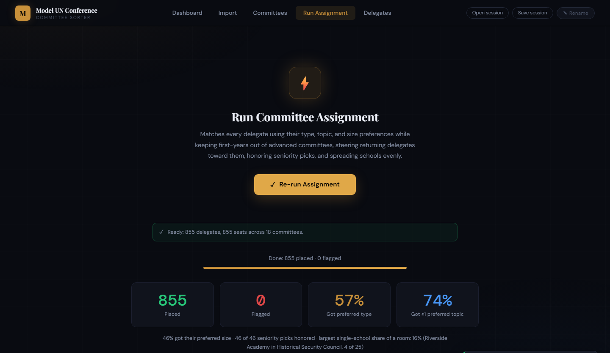

# MUN Committee Sorter

Sorts Model UN delegates into committees from your registration spreadsheet in seconds, then gives each one a country.

## ⬇ Download

| Your computer | Download |
|---|---|
| **Windows** | **[MUN-Committee-Sorter-Windows.exe](https://github.com/asuarcia/MUN-Sorting-Algorithim/releases/latest/download/MUN-Committee-Sorter-Windows.exe)** |
| **Mac** | **[MUN-Committee-Sorter-Mac.dmg](https://github.com/asuarcia/MUN-Sorting-Algorithim/releases/latest/download/MUN-Committee-Sorter-Mac.dmg)** |
| **Linux** | [MUN-Committee-Sorter-Linux.AppImage](https://github.com/asuarcia/MUN-Sorting-Algorithim/releases/latest/download/MUN-Committee-Sorter-Linux.AppImage) |
| **No install** (Chromebook, school laptops) | **[Open in your browser](https://asuarcia.github.io/MUN-Sorting-Algorithim/)** |


> **First launch warning:** the app isn't code-signed (meaning it's not officially verified), so your computer will label a warning.
> - **Windows:** "Windows protected your PC" → **More info** → **Run anyway** (*completley safe to download and run*)
> - **Mac:** open the `.dmg`, drag the app to Applications, open it. If it's blocked, go to **System Settings → Privacy & Security → Open Anyway**.



---

## How to use it
The following are directions that are also within the program itself once downloaded/opened

1. **Import.** In Airtable, open the registration table and **Download CSV** (or export to Excel), then drop the file in. It's set up for the 2027 GPY Model UN registration form, so no columns need renaming. Other forms work too.
2. **Committees.** The default line-up is the 18 committees on the [GPY Model UN committees page](https://www.gpyce.org/mun-committees), each tagged with the form interests its 2027 topics cover. Adjust names, seats, topics, countries, and whether each is Beginner, Intermediate, or Advanced to fit your conference. The app remembers them for next time.
3. **Run.** Click **Run Assignment**. Every delegate gets a seat and a country, and the app warns you first if you don't have enough seats.
4. **Review & export.** Click any committee to see who's in it and **Move** people by hand. Hand placements stick if you re-run. Then **Export rosters (Excel)** to get one file with:
   - a summary,
   - every delegate and *why* they got their committee,
   - a list per school for faculty advisors,
   - a roster per committee for chairs, in country order.

**Save session** keeps your work in a file so you can close the app and pick up later, or hand it to a co-organizer.

---

## Your spreadsheet

The defaults match the **2027 GPY Model UN** Airtable registration form. These are the fields the app reads, under the form's own names. Headers are case-insensitive, any order, and close variants (`Full Name`, `School`, `Interests`, `Committee size`) work too.

| Form field | Answers |
|---|---|
| First Name · Last Name · Preferred First Name | Rosters use the preferred first name when there is one |
| Delegation | The delegate's school delegation. Used to spread delegations across rooms |
| Grade | 9 · 10 · 11 · 12 |
| Are you a first-year delegate or returning? | First year delegate · Returning |
| What are your interests in Model UN? | Any of: Technology · Health · Environment · Economic · Law · Social Justice/Human Rights · History · Military/Conflict Resolution · Social Media |
| Please select ALL committee sizes you are interested in | Small (20-40) · Medium (40-70) · Large (70+) · No preference on committee size |
| Seniority Pick *(optional, not on the form; add the field in Airtable)* | A committee name or acronym (`ICJ`, `Security Council`) |

A sheet with a `Preferred Type` column (Regional Summit, Court, …) is still scored on it. The GPY form doesn't ask for it, so it's ignored when absent. There's a **Download blank template** button on the Import screen that uses the same headers.

### 🔒 Privacy

Everything runs on your computer. Nothing is uploaded, not even in the browser version. The app reads **only** the fields above. It ignores and never stores birthday, gender, pronouns, email, address, emergency contacts, insurance, allergies, signatures, and every other field, and the import screen lists exactly what it read and what it skipped.

---

## How it decides

- **First-years are kept out of Advanced committees, with a few exceptions.** It isn't a hard rule. A first-year only lands in an Advanced committee when it fits their interests and sizes much better than any other committee (by more than a whole extra interest), and each Advanced committee takes at most 10% of its seats in first-years (at least 1, so 2 of 25). In practice, that's a handful per conference: 2 of 358 first-years in the 855-delegate test data. Their placement reason says so, so you can move them out by hand if you want. Returning delegates are steered toward Advanced committees.
- **Seniority picks** get a very strong boost, as long as the committee has room. A first-year's pick for an Advanced committee also counts against that committee's first-year seats.
- **Interests** are matched against each committee's topics. Committees use the form's nine interests by default, and older words like "Healthcare" or "Security" still count.
- **Sizes:** committees in a size the delegate ticked are favored, and ones they left unticked are avoided. "No preference" (or ticking all three) is neutral.
- **Grade:** returning 11th and 12th graders get an extra nudge toward Advanced committees and pick before younger delegates.
- **Delegations are spread out** so no single school dominates a room.
- If every committee a delegate is allowed into is full, they're **flagged** so you can place them by hand.

### Countries

Once everyone has a committee, each delegate gets a country. Returning delegates tend to get the more significant ones, especially in big committees, but it's a strong tendency, not a rule.

- **Each committee has a ranked position list.** It starts with the committee's own countries, most significant first, then fills the remaining seats from a pool (a region or the world), also most significant first. A region that runs out (MENA has 23 countries for 30 seats) continues with the rest of the world as observers. Defaults:
  - **Security Council:** the P5, then the ten elected members sitting in 2026. *Update the elected ten for your conference year.*
  - **G20:** its 19 countries plus the EU and the African Union. Extra seats go to the next-largest countries as guests.
  - **Regional summits:** that region's countries.
  - **Topic committees and the General Assembly:** the whole world.
  - **Historical Security Council:** a 1980s council (Soviet Union, West/East Germany, …) plus the parties to the 2027 crises.
  - **Nation Building:** the 2027 topic's eight nations, with about 15 delegates on each nation.
  - **Courts and Press:** no countries.
- **How significant a country is** comes from a built-in table of all 193 UN members (plus Palestine as an observer) in four tiers: major powers (P5, Germany, Japan, India), big players (Brazil, Canada, Saudi Arabia, Turkey, …), regional powers, and everyone else.
- **Delegates are ranked by experience within their own room:** returning first, then grade. Ranking within the room, rather than against a fixed bar, means it adapts to whoever is there. A room with only 3 returners gives them top countries and then hands the next most significant ones to the oldest first-years. A room with no returners goes by grade.
- **Not strict:** a small, fixed amount of shuffle is added to each delegate's rank (the same every run, so re-running doesn't change countries). Big rooms get the least shuffle, because a major power in a 120-seat General Assembly has to carry a lot of delegates. In the test data, a first-year ends up with a more significant country than a returning delegate in the same room in about 6% of pairs in Large committees, 9% in Medium and 15% in Small (0% would be strict, 50% random). The most significant fifth of a room almost always goes to returners when there are enough of them; the mixing happens below that.
- **Moving someone by hand** re-deals the countries in the two rooms involved, so check rosters after moves.

You can change any committee's countries on the Committees tab: list its own countries, most significant first, and pick what to fill the remaining seats from.

After each run, you see how many delegates got one of their interests and a size they picked, how many seniority picks were honored, the share of each room's most significant countries held by returning delegates, and the largest share of any room held by one school. Before a run, the app warns about committees whose seat count doesn't fit the form's size ranges, and interests no committee covers.

---

<details>
<summary><b>For developers</b></summary>

```bash
npm install
npm start          # run the desktop app
npm test           # headless checks: rules, CSV parsing, confidentiality
npm run dist       # build the Windows .exe into dist/
npm run web        # build the browser version into _site/
python make_mock_data.py   # regenerate fake test spreadsheets (includes fake PII on purpose)
```

| File | Purpose |
|---|---|
| `index.html` | The whole UI |
| `engine.js` | Parsing + assignment rules. Shared by the app **and** the tests. `FIRST_YEAR_ADVANCED` sets the first-year penalty and seat share; `COUNTRY_TIERS`, `DEFAULT_POSITIONS` and `COUNTRY_JITTER` drive countries |
| `main.js` | Electron desktop wrapper |
| `vendor/` | Excel reader/writer (SheetJS) and fonts, bundled so it works offline |
| `test/verify.js` | Rule and confidentiality checks |

**Releasing:** bump `version` in `package.json`, then `git tag v1.x.x && git push --tags`. GitHub Actions builds Windows, Mac and Linux and attaches them to a release. The download links above always point to the latest one. Every push to `main` also redeploys the browser version.

</details>

MIT License
